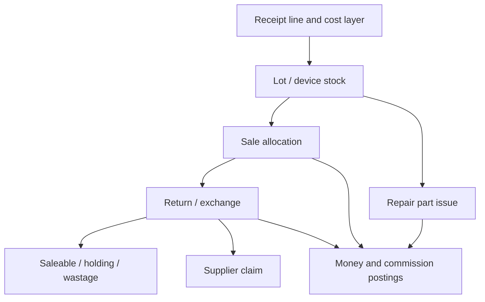

# Fido Operations System
## Complete build specification · v1.0 · 31 October 2026

**Purpose:** Replace the shop’s current Clicky POS with a coherent system for sales, stock, lots, purchasing, repairs, people, payroll, accounts and remote shop operations. Preserve familiar working patterns while improving clarity and adding the requested reload, bus-parcel and SMS workflows.

**Status:** Final development baseline for the scope described in this conversation. This is not a claim that every legacy implementation detail has been tested. Explicit proposed defaults let development proceed while a short list of financial, device and migration checks remains mandatory before live use.

**Authoritative order:** Decisions in this specification override the earlier exploratory audit and blue return-screen concept. The audit remains the evidence log. Current-system observations, new requirements and proposed implementation rules are distinguished below.

**WooCommerce is excluded from the replacement.** No WooCommerce menus, product sync fields, permissions, credentials, API settings, synchronization jobs or WordPress dependency. Historical source identifiers may be retained as inert migration metadata. Nothing has been disabled or removed from the live shop system.

## Contents

1. Scope and evidence
2. Navigation and whole-system design
3. Screen catalogue
4. Users, roles and access
5. Contacts and master data
6. Products, lots and inventory
7. Purchasing and GRNs
8. POS, sales, payments and registers
9. User, agent and target commissions
10. Reload wallets and remote reloads
11. Returns, exchanges, supplier recovery and wastage
12. Repairs and device handling
13. Bus parcels and staff alerts
14. HRM: holidays, leave, attendance and payroll
15. Invoices, receipts, labels and printing
16. Accounts, expenses and cheques
17. Reporting catalogue and definitions
18. SMS and notification operations
19. Essentials and administration
20. Data model and transaction architecture
21. API and event contracts
22. Migration and cutover
23. Nonfunctional requirements
24. Acceptance checks
25. Complete delivery sequence
26. Decisions and verification gates
27. Evidence and legacy coverage
28. Category commission snapshot

## 1. Scope and evidence

### 1.1 Included scope

All observed functional areas remain included unless explicitly excluded here. Delivery phases sequence the work; they do not silently remove later modules from the agreed scope.

| Area | Required coverage |
| --- | --- |
| Home | Operational summary, dues, stock alerts, daily tasks and owner monitoring. |
| User Management | Users, login control, roles, location/contact scope, employee and commission profiles. |
| Contacts | Customers, suppliers, groups, credit limits, opening/advance balances, history and import. |
| Products | Single/variable/combo products, SKU/barcode, units/conversions, categories/subcategories, brands, price groups, warranties, device models and imports. |
| Inventory | Receipt-level lots and costs, serial/IMEI tracking, opening stock, stock ledger, reservations, transfers, adjustments and blocked/wastage stock. |
| Purchases | Purchase orders, receiving/GRNs, supplier bills, payments, attachments and supplier returns. |
| Sell | POS, ordinary sale entry, sale history, drafts/suspended sales, quotations/orders, subscriptions, returns/exchanges, discounts, shipments and sales import. |
| Repairs | Job sheets, intake/checklists, PIN/pattern, estimates, technician work, parts, invoices, warranty, stickers and updates. |
| Reloads | Provider/channel wallets, funding, commissions, customer reload outcomes and remote requests. |
| Staff Tasks | Bus parcels, collection/receiving confirmation, alarms, acknowledgement, escalation and task history. |
| Expenses and Accounts | Expense categories, recurring expenses, accounts, payments, transfers, deposits, cheques and reconciliation. |
| HRM | Departments/designations, shifts, attendance, holidays, leave types/requests, payroll groups/components/runs, payslips and targets. |
| Reports | All observed reports plus the new operational, reload, return/recovery and HR/payroll views. |
| Notifications | Text.lk integration, SMS invoices/receipts, repair updates, reminders, event history and failures. |
| Essentials | Tasks, documents, memos, reminders, messages and knowledge base. |
| Settings | Business/locations, fiscal/calendar/precision rules, document numbering, invoice layouts, printers, barcode/label layouts, tax, modifiers, service types and custom fields. |

Excluded: WooCommerce/e-commerce integration; copying Clicky vendor activation/licensing screens; unverified restaurant/manufacturing business workflows that appear only as generic permissions/layout options. The observed Modifiers and Types of service screens are retained as configurable master data. If historical data proves additional production workflows are active, record them as a scope amendment rather than pretending they were inspected.

### 1.2 Evidence classification

- **Observed:** Visible current configuration, fields, lists and specified existing records.
- **Requested:** Explicit business requirements supplied by the user.
- **Proposed:** New-system behavior defined here to make implementation concrete.
- **Verification gate:** A particular rule/device/data check required before that feature is used live; it does not block unrelated development.

Observed core settings: LKR; FIFO; lot numbers enabled; purchase statuses enabled; purchase orders enabled; warranties enabled; overselling disabled; January financial-year start; invoice-value staff/agent commissions; two displayed currency/quantity decimals; nearest-0.5 sale rounding. The existing time zone is Asia/Kolkata. The replacement uses Asia/Colombo for business dates and preserves historical instants carefully; both currently have the same offset.

The live POS requires opening a cash register. No register was opened, so its exact checkout layout, keyboard mappings, lot-selection override and special damage/exchange entry remain untested. Viewing forms did not submit any sale, payment, payroll, leave approval or stock transaction.

## 2. Navigation and whole-system design

### 2.1 Design identity

Use a restrained shop-workbench identity: graphite navigation, warm paper workspace, precise numerical columns, narrow dividers and a brick-red action accent. Avoid generic purple/blue gradients, glass panels, floating decorative cards, oversized greeting banners, excessive pills and charts that displace the work.

| Token | Light theme | Dark theme | Use |
| --- | --- | --- | --- |
| Canvas | #F3F0E8 | #171A18 | Workspace background. |
| Surface | #FFFDF8 | #222622 | Forms, tables and dialogs. |
| Navigation | #242A26 | #111512 | Stable left menu/header. |
| Main text | #242A26 | #ECEDE6 | Body and numbers. |
| Secondary text | #62695F | #B5BCAE | Supporting labels, never critical amounts. |
| Rule | #D7D4CA | #41483F | Table/form separation. |
| Primary action | #A83E2B | #D7755F | One decisive action in a work area. |
| Confirmed | #35634B | #A7C7AB | Text plus success/status icon. |
| Attention | #85601E | #D6B979 | Pending/review indicators with labels. |
| Error | #A22F38 | #ED9AA0 | Validation/destructive actions. |

Typography: practical local font stack with Sinhala/Tamil coverage where needed; 14px default desktop body, 13–14px dense tables, 16px editable mobile inputs, 22–26px page titles. Tabular numerals for money/quantities. Four-pixel spacing scale, 4–6px control radii, restrained 1px rules. Touch targets at least 44px. Validate contrast and printed glyph coverage on the actual fonts/devices; the palette itself is not a compliance certificate.

The earlier blue return prototype is superseded by this visual direction. Familiarity is preserved through navigation, labels, document references and task order rather than copying all old styling.

### 2.2 Familiar information architecture

Keep existing top-level relative order: Home; User Management; Contacts; Products; Repair; Purchases; Sell; Stock Transfers; Stock Adjustment; Expenses; Payment Accounts; Reports; Notification Templates; Settings; HRM; Essentials. Add **Reloads** and **Staff Tasks** as clearly identified new destinations and persistent task shortcuts. Remove WooCommerce entirely.

Keep top POS and Repair shortcuts; display location, active user, register state and alert connectivity. Location is ordinary text when there is only one permitted location. Changing location during a draft must require resolving the draft rather than silently moving its quantities/accounts.

Preserve terms such as Sell Return, Lot Number, Purchase, User Commission and Agent Commission. Pair ambiguous terms with explanations: “Receive goods / GRN” and “Sell Return / Exchange”. Retain original invoice/PO/CN/SA references and legacy IDs in migrated detail views.

### 2.3 Interaction patterns

- Table pages: title and primary action; compact filter strip; dense aligned table; source-document drill-through; totals clearly identified as page totals or all filtered totals; exports respect the same filters and permissions.
- Transaction pages: document context above item grid; side/bottom summary of money and stock consequences; one review/commit action. Keep lot, original price, quantity and balance visible.
- Detail pages: original document, linked movements/payments, changes and notification history. Never replace history with an unexplained edited total.
- Form sections: essentials first; expandable advanced fields; validation beside the input. Do not hide a field needed to choose the right lot, recipient or payment method.
- Dialogs: small lookup or focused confirmation only. Complex return/payroll/receiving work belongs on a page rather than stacked modal windows.
- Lists retain scanning, keyboard focus and user-selected columns. Provide an accessible shortcut reference; import/verify old shortcuts before assigning conflicting new ones.
- Staff mobile view prioritizes assigned tasks, acknowledgements and repairs; owner mobile view prioritizes exceptions, collections, balances and approvals. Desktop POS remains compact and scanner-friendly.

## 3. Screen catalogue

Each row is a required screen family, not merely a menu placeholder. Every screen must implement loading, empty, error, permission-denied, success and unsaved-change states. The design preview is illustrative; this catalogue defines the full build scope.

| ID | Screen | Required structure and primary actions |
| --- | --- | --- |
| H01 | Home / owner overview | Sales/collections/dues summary with named basis; pending reload/bus/repair/stock exceptions; existing trend views below useful work. Drill into filtered records. |
| U01 | Users | Search/type/role/location/status filters; login state, commission class and role columns. Add, view, deactivate; do not delete historical identity. |
| U02 | User / employee profile | Identity; login; role; locations/contacts; discount/price limits; commission; HR; salary history; restricted bank details. Effective-dated changes. |
| U03 | Roles | Module/action/scope matrix; compare effective rights; safe role assignment and change history. |
| C01 | Customer/supplier list and profile | Contacts/groups; transactions, dues, advances, credit, returns, documents and ledger. Record/reconcile payments. |
| P01 | Product list/detail | SKU/name/category/brand/type; available vs blocked stock by location; lots, receipts, costs, IMEIs, prices, warranty and movements. |
| P02 | Product editor | Essentials; variants/combo components; stock/device flags; pricing/tax; warranty; media/custom fields. No WooCommerce controls. |
| P03 | Catalog masters | Categories/subcategories and commission settings; brands; units/conversions; variants; warranties; device models; selling-price groups. |
| P04 | Imports/opening stock | Upload, map, dry-run, row errors, duplicate detection, review, commit and reversal reference. Opening stock by lot/cost/location. |
| I01 | Lots / stock ledger | Product-location-lot/receipt filters; received/sold/returned/adjusted/remaining; cost lineage; source drill-through. |
| B01 | Purchase orders | Draft/order/receipt progress; supplier, quantities remaining, shipping and linked receipts. |
| B02 | Receive goods / purchase | Supplier/document/status/location at top; quantity/cost/lot grid; tax/charges; receiving and payment summaries distinct. |
| B03 | Purchase detail / supplier return | Received lines/lots, payment state, linked return/recovery and documents. Create controlled return against source lines. |
| S01 | POS | Scan/search and customer strip; item/lot/cart grid; visible commission mode/recipients; amount due; cash/card/mixed/credit choices; suspend/draft; receipt/SMS outcome. |
| S02 | Add sale | Familiar full-page invoice for non-POS workflows with date/status, line prices/discounts, tax, shipping, payment and notes. |
| S03 | All sales / POS history | Existing filters plus original/net/returned totals; source, staff/agent, payment/shipping states. View, payment, return/exchange, print, send receipt. |
| S04 | Sale detail | Immutable original lines and values; retained/returned quantities, cost allocations, commissions, payment/refund/credit ledger, shipments and history. |
| S05 | Drafts / quotations / orders / subscriptions | Convert explicitly, scheduled invoice generation where configured, fulfilment progress; no duplicate stock posting. |
| S06 | Return / exchange | Find original; quantity/reason; customer settlement; item disposition; replacement/credit; review linked money/stock/commission effects. |
| S07 | Supplier recovery / wastage | Blocked return queue, supplier claim and dispatch, credit/replacement/rejection, write-off and recovery history. |
| S08 | Discounts / shipments | Time/category/product/location-scoped discount priority; shipment preparation, status, delivery and COD reconciliation. |
| R01 | Repair queue | Jobs by status, technician, promised date and overdue state. Intake, estimate, parts, ready/collected and customer update actions. |
| R02 | Repair intake | Customer/device/IMEI; PIN/pattern under restricted access; SIM/card/accessory checklist; condition/problem/photos; estimate/status/delivery; print job sticker. |
| R03 | Repair job / invoice | Timeline, diagnosis/approval, parts reservation/issue/return with lot, labour/external costs, deposits/balance, warranty, handover and restricted credential purge. |
| L01 | Reload wallets | Provider/channel, nominal balance, funding and commissions; ledger/reconciliation; separate funded and sale-earned benefit. |
| L02 | Reload request / execution | Owner request; staff claim/ack; destination/provider/amount/payment; manual provider outcome; uncertain result handling; linked sale once. |
| T01 | Staff task inbox | Immediate pending/acknowledged/overdue/completed groups; persistent alarm/permission/connection state; explicit acknowledgement. |
| T02 | Bus parcel | Bus/route/contacts/ETA/stop/package; assigned worker; alert, collected, contents checked, discrepancy and linked GRN. |
| ST01 | Stock transfer | Source/destination; lot/cost grid; dispatch/in-transit/receive; discrepancies and reversals. |
| SA01 | Stock adjustment | Product/lot/quantity/cost; normal/abnormal compatibility; plain reason/disposition; recovered value; review/audit. |
| F01 | Expenses | Categories/subcategories, contact/employee, dates/tax/recurrence, payment state, attachment and expense allocation. |
| F02 | Accounts / cash flow | Account/type, balance and filtered ledger; deposits/transfers/reconciliation; source payments, not free-floating untraceable totals. |
| F03 | Cheques | Issue/expected realization dates, instrument/ref/type/account/contact/status; clear/bounce/reverse without duplicating source payment. |
| F04 | Registers | Opening cash/location/user; movements and expected count; closing denomination counts, variance, notes and manager review. |
| HR01 | HRM overview | Own/team leave, holidays, attendance exceptions, target progress and payroll period status. |
| HR02 | Leave types / applications | Caps/interval/paid-unpaid policy; dated request; overlap/balance check; approve/reject/cancel with history. |
| HR03 | Holidays | Location/all-location date ranges, name and notes; calendar/list; effect on scheduled work and leave preview. |
| HR04 | Shifts / attendance | Shift templates and assignments, overnight shifts, clock events/corrections/import; duration/late/absence exceptions. |
| HR05 | Pay components | Earning/deduction, fixed/percentage, basis, employee scope, effective/applicable date and recurring/one-time rule. |
| HR06 | Payroll runs / groups | Employee-period selection; attendance/salary snapshots; earnings/deductions/commission references; exceptions, approval, partial/full payment and locked revision. |
| HR07 | Payslip / own payroll | Work duration, itemized earnings/deductions/rates, net pay, payments and references; print/PDF; self-only access where appropriate. |
| HR08 | Sales targets | Eligible sales period and non-overlapping bands; configured tax basis; achieved sales and separately labeled target earning. |
| RP01 | Reports hub | Search by operational question; familiar report names/categories; saved permitted filters and basis labels. |
| RP02 | Report detail | Period/location/basis; relevant filters; reconciliation totals, drill-through, export and print. See complete catalogue below. |
| N01 | Notification templates / log | Event/language template and preview; approved sender; send/failed/delivered/unknown history; controlled retry. |
| A01 | Business / locations | Business defaults, fiscal dates/precision, location identities and contact/printing/default-price settings. |
| A02 | Numbering / invoice layouts | Separate scheme sequences and document layouts; real preview; versioned headings/fields/tax/lot/warranty/QR choices. |
| A03 | Printers / stock and repair labels | Printer profiles, paper/layout dimensions and separate label templates; test page/job outcomes and reprint history. |
| A04 | Tax / service types / modifiers | Inclusive/exclusive tax; configurable service packing/charges; modifier sets assigned to products if used. |
| E01 | Essentials tasks | Priority/status/start/end/hours/assignee, attachments, activity and linked business object. Bus/reload tasks use this shared task foundation. |
| E02 | Documents / memos | Upload/version/classify/access/download; memo headings/content and restricted audiences. |
| E03 | Reminders / messages | Calendar recurrence and time-zone-aware reminders; permission-scoped internal communication and read states. |
| E04 | Knowledge base | Categories/articles, search, access, revisions and shop procedures. |

## 4. Users, roles and access

**Observed:** User type filters distinguish ordinary users, commissions-only, commission users and commission agents. User setup includes active state, Allow login, role, allowed locations, selected contacts, maximum sales discount, commission ID/type/rate, HR details, bank details, basic salary and pay components. Salary periods offered are per month/week/day. Existing role names include Admin, Cashier, Agents and custom roles.

### 4.1 Required identity model

Separate Person, LoginAccount, EmployeeProfile and CommissionProfile. One person may hold several profiles without duplicate identity. A referral agent need not be an employee or have login access. A salesperson’s commission eligibility is not identical to being logged in or creating the invoice. Store creator, salesperson and referral agent separately.

Support active/inactive records, invitation/password reset, session revocation, location and optional contact scopes, effective salary history and staff document/bank data. Inactive identities remain attached to historical transactions. Never migrate passwords in plaintext; establish a supported credential migration/reset method.

### 4.2 Proposed default permission matrix

O = all permitted business locations; L = assigned locations; Own = own/assigned records; Review = approval-limited; — = no default access. These are **new defaults**, not a claim about current effective permissions. Custom roles and imported legacy role labels remain available.

| Capability | Owner/Admin | Manager | Cashier | Stock clerk | Technician | HR/Payroll | Agent |
| --- | --- | --- | --- | --- | --- | --- | --- |
| Users/roles/business settings | O | Review | — | — | — | Employee details only | Own profile |
| Sales/payments/register | O | L | L | — | Assigned repair collection only | — | Own referrals read-only |
| Price/discount override | O | Configured limit | Configured limit | — | — | — | — |
| Product costs/profit | O | Granted L | Hidden by default | Granted purchasing cost | Assigned part availability only | Payroll costs only | Own commission only |
| Receiving/transfers | O | L | Only if granted | L | Request parts | — | — |
| Refunds/write-offs | O | Review L | Within granted limit | Stock handling only | Diagnosis only | — | — |
| Repair credentials | O if explicitly authorized | Granted jobs | Intake only if granted | — | Assigned jobs | — | — |
| Commission rules/payout | O | Review | Own statement | — | Own statement | Approved payroll inclusion | Own statement |
| Leave/attendance | O | Team review | Own | Own | Own | O | — unless employee |
| Payroll/bank details | O | Explicit grant only | Own payslip | Own payslip | Own payslip | O | Own commission payment only |
| Reports/export | O | Granted L | Granted operational L | Granted inventory L | Own/assigned | Granted HR | Own only |
| Integration/SMS configuration | O | Explicit grant | — | — | — | — | — |

Enforce scope and field permissions on the server and exports, not merely by hiding buttons. Rights include view/create/update/reverse, approve, pay/refund, cost visibility, export, print, SMS, price groups, backdating and location access.

The inspected legacy Cashier role has broad user/role/settings privileges. Preserve the ability to configure rights, but do not silently use that role’s broad settings as the replacement’s default. Review imported assignments as part of migration; do not change the live role during discovery.

## 5. Contacts and master data

Customer/supplier record: individual/business type, code, names, company, phones/email, addresses, tax identifiers, group, assigned user, location scope, source/lifecycle/custom fields, payment terms, credit limit, opening balance and attachments. Track sales/purchases, receipts/payments, returns, credits and advances through a ledger. A person may be both customer and supplier; balances remain explicitly classified.

Customer groups and selling-price groups are independent. Preserve existing price groups and per-role access. Define discount priority for product/category/brand/location/date range; show the applied rule and prevent unintended stacking.

Catalog masters: categories/subcategories with stable IDs and commission rates; brands; units with decimal flag and conversion factors; variation templates/values; warranty names/descriptions/durations; device brands/models; service types and packing charges; modifier sets/products; tax rates/groups; expense categories/subcategories. Referenced master records are deactivated, not destructively removed.

## 6. Products, lots and inventory

### 6.1 Product definition

Support Single, Variable and Combo types. Required fields: name, SKU, barcode type/value, unit/subunits, category/subcategory, brand, locations, stock-managed/not-for-selling flags, alert level, warranty, device model, description, image/brochure, weight, four compatible custom fields, tax-inclusive/exclusive prices, purchase-cost default, selling-price groups, margin and minimum/maximum selling price.

The current product option combines description, IMEI or serial entry. Preserve its legacy content and add structured individual-device records for phones: IMEI1/IMEI2/serial, condition (new/used), purchase line, current location/state, purchase cost and warranty. Do not invent IMEIs, strip leading zeros, or merge distinct devices by product name. Trade-in/buyback uses a separate acquisition document and valuation if enabled; its policy is not assumed from the word “reselling”.

### 6.2 Lot/cost identity

Lot code is text, not a global primary key. The same code is used across different products on a received purchase. Track at least product/variation + location + receipt line + lot reference. Keep stable internal receipt-line IDs, quantities, costs, currency/rate, dates and source document.

Maintain stock buckets: saleable, reserved, inspection/returns hold, supplier-recovery hold, in-transit and written-off. Available = saleable minus active reservations. Physical on-hand and available must be labeled separately.

### 6.3 Movement rules

- Every posted change is an immutable movement with source type/ID, product, unit conversion, lot/device, location, quantity, cost basis, actor and time.
- Received accepted quantities increase stock once. Draft/ordered/pending documents do not add available stock under the proposed model; legacy status effects must be confirmed before importing live transitions.
- Default allocation is FIFO across eligible accepted cost layers. Explicit lot/device selection must reserve the chosen available layer and record its exact allocation. Test current override behavior before claiming parity.
- No new negative availability by default. Handle concurrent tills through transactional reservation/allocation; a quantity shown on a stale screen is not a guarantee.
- Preserve costs after consumption. Correct posted receiving through controlled reversals/adjustments; never silently rewrite all historical profit when a default price changes.
- Transfers retain lot/device/cost lineage; source dispatch and destination receipt are linked and cannot each create a second purchase cost.
- Opening stock/imports use the same movement model and preserve per-lot remaining cost layers.

Inventory reconciliation: opening + received + customer returns + transfers in − sold/issued − supplier returns − transfers out − write-offs ± corrections = physical stock, with reservation/holding classifications reconciled separately.

## 7. Purchasing and GRNs

**Observed:** The current purchase reference prefix is PO; Purchase Orders are separate. Received purchase lines include lot, quantity and before/after discount/tax costs. An inspected received purchase remains unpaid, proving that stock receipt and supplier payment are separate.

Implement PurchaseOrder, GoodsReceipt and SupplierBill as distinct linked records even if the familiar UI combines receiving and billing. Preserve legacy purchase reference, supplier invoice/reference and old IDs. Suggested statuses:

| Record | States | Stock/payment consequence |
| --- | --- | --- |
| Purchase order | Draft, Ordered, Part received, Received, Closed, Cancelled | No stock by itself. |
| Goods receipt | Draft, Checked, Posted/Received, Reversed | Accepted quantity posts once; rejected/damaged incoming goods remain unavailable. |
| Supplier bill | Draft, Posted, Part paid, Paid, Credited/Reversed | Payable/payment state independent from receipt. |

Receiving screen: supplier, location, reference/date, optional order links and attachment; item/lot grid with ordered/received/accepted/rejected quantities, unit conversion, original cost, discounts, tax, optional landed-charge allocations and selling-price changes. Show unreceived order balances; detect over-receipt and duplicate supplier references according to configured policy.

Support multiple partial receipts and bills against an order. Supplier payments settle payable records without adding stock. A bus parcel’s collected status does not post a GRN; checked accepted contents do.

Supplier returns/claims reference original receipt lines, lot/device and supplier. Track requested quantity, dispatched quantity, accepted credit, money/replacement received and rejection. Do not treat expected recovery as cash already received.

## 8. POS, sales, payments and registers

### 8.1 Sale transaction

Preserve scan/search by product/SKU and supported lot/device lookups; customer selection/quick add; price group; line quantity/price/discount/tax/warranty; salesperson/referral agent; sale date/status; invoice scheme; service/source; notes; shipping; mixed payments and change.

Use explicit independent dimensions: document stage, payment state and fulfilment state. Draft/suspended/quotation/order records reserve or do not reserve only according to a visible configured rule; posting a final sale consumes stock once. Quotations do not post revenue or stock. Recurring subscriptions generate an idempotent draft/invoice for each scheduled period, never repeated stock on retries.

Persist original price, discounts, taxes, total, rounding, cost allocations, commission snapshots, source and creator. Treat refunds/returns as linked documents. Posted edits that affect money or stock produce a version/reversal trail.

### 8.2 Payment and credit

Cash, card, bank transfer, cheque, advance, store credit and configured custom methods have explicit accounts/references. Never store card security codes. Partial payments and multiple methods remain separate payment allocations. Show amount paid, remaining due, change and customer-wide balance distinctly. Enforce credit limit/terms using current balances and authorized overrides.

Payments collected by a remote owner are recorded against the owner’s designated collection account, not silently added to the shop till. A customer promise is not a payment.

### 8.3 Register

Opening: location/user, opening cash and time. Track cash sales/collections, cash refunds, authorized cash-in/out, deposits, expenses and paid commissions/payroll only when that register actually supplies the cash. Keep bank/card/cheque totals separate.

Closing: expected cash = opening cash + actual cash receipts + cash-in − actual cash refunds − cash-out. Record counted denominations, actual cash, variance, notes and reviewer. Opening/closing never fabricates a sale. Closed register/period changes use explicit corrections with audit history.

### 8.4 Shipping

Preserve invoice link, delivery address/contact, charges, documents, delivered-to and shipping status. Proposed states: pending, packed, dispatched/shipped, delivered, returned/cancelled. COD remittance is its own payment/reconciliation event; shipping a parcel does not mark it paid.

## 9. User, agent and target commissions

### 9.1 Category split

Current data stores category pool rate, user share and agent share. Shares apply to the commission pool. For each eligible line:

`pool = eligible_net_line_value × category_rate`

`user_allocation = pool × user_share`

`agent_allocation = pool × agent_share`

Modes: None, User, Agent, Dual. User-only pays only the configured user allocation; it does not award the absent agent’s share to the salesperson. Resolve separate recipients explicitly. Store original category/subcategory IDs, rates/shares, basis, amounts, recipients and allocation version per sale line.

Current basis is Invoice value; Payment Received is also offered. Proposed initial default retains invoice-value accrual on net line values excluding shipping, as supported by the checked example. Taxes, invoice-level discounts and exact rounding/dual behavior require regression checks. Payment-received mode allocates accrual by settled eligible value and explicitly adjusts reversals.

Examples of observed configured effective rates: Back Covers total 9%, user approximately 2%, agent approximately 7%; Chargers 4% split 1%/3%; Smartphones 1% split 0.2%/0.8%; Android phones 0.8% split 0.1%/0.7%. All 120 category rows are retained in the appendix.

### 9.2 Accrual, approval and payout

Separate commission accrual, return reversal, approval, payroll inclusion/direct payout and settlement. A payout references approved allocations once; it does not create the expense again. Returns use original snapshots; already-paid commission becomes an explicit adjustment, not an unexplained edit to the old payment. Payroll and direct payment must share a unique settlement reference.

Do not silently normalize legacy shares: Charging Docks currently shows 33% + 66% = 99%. Flag imported exceptions; require a deliberate rule decision for new configurations. Duplicate category names remain distinct IDs.

### 9.3 Sales targets

Current HRM target setup has sales-from, sales-to and commission-percent bands; its separate setting can exclude tax. Preserve target schemes as a separately labeled incentive. Configure period, eligible sales/returns, tax basis and flat-band versus progressive calculation. Proposed default: disabled until a scheme is configured; no automatic stacking into category commission. Reject overlapping/ambiguous bands and store the evaluated scheme snapshot.

## 10. Reload wallets and remote reloads

Use Provider, FundingChannel, Wallet, FundingTransaction, CommissionRule and ReloadTransaction. Preserve separate current provider and Mega Pay channels; support a shared aggregator wallet when configured, rather than duplicating one balance for every network.

Ledger fields: nominal credit/debit, actual money paid/received, bonus credit, separate commission, fees, reference, timestamps, effective rule and reconciliation status. Supported modes: discounted acquisition, bonus nominal credit, commission per successful reload and periodic settlement if configured. Distinguish those modes mathematically; never recognize the same funding benefit and sale margin twice.

Observed catalog defaults: Dialog/Mobitel 0.96 purchase per 1.00 nominal sale; Hutch 0.94/1.00; Airtel 1.00/1.00. A Mobitel receipt records 10,000 nominal units for LKR 9,600. These are current record examples, not nationwide commission rates or verified provider settlement terms.

Initial implementation supports the observed cost-spread model and configurable additional provider rules. Unknown rules stay unconfigured; funding benefit timing must not be invented. Track accrued versus credited commission separately.

Remote request: owner enters number, network/channel, amount, customer, payment/collection context, notes and assignee/location. Staff receives alert, acknowledges, claims, performs the reload through the approved existing provider method and records a reference/result. Successful confirmation creates one sale and wallet movement. States: requested, acknowledged, processing, successful, failed, uncertain, cancelled, expired. Uncertain responses must be reconciled before another recharge; no automatic financial retry.

Direct provider API execution is not assumed. The requested first implementation is a controlled staff task plus recorded outcome. Bill-payment services remain distinct if fees/settlement differ.

## 11. Returns, exchanges, supplier recovery and wastage

Separate customer settlement from physical disposition and supplier recovery. One return can give the customer an immediate exchange while the item waits for a supplier decision.

Required flow: locate original sale → select original lines/remaining returnable quantities → reason/condition → destination → customer settlement/replacement → review stock/money/commission effects → commit linked records once.

| Dimension | Choices and required result |
| --- | --- |
| Customer | Refund, store credit, exchange credit, debt offset; preserve actual allocations and amount still owed in either direction. |
| Item | Saleable original lot, inspection hold, supplier-recovery hold, repair/recondition if enabled, wastage/write-off. Damaged items do not become available for sale. |
| Supplier | Claim pending, sent, accepted credit/refund/replacement, partial recovery, rejected; actual recovery separate from expectation. |

An exchange uses a linked replacement sale, not a hidden discount that loses the return history. More-expensive replacement: collect the difference. Cheaper replacement: explicitly resolve excess through permitted refund/credit. Unpaid sales offset debt before calculating refundable/creditable entitlement; check prior refunds/credits as well as original payments.

Retain original lot/device and cost allocation, actual selling/discount/tax snapshot, returned quantity and disposition partition. Cumulative returns cannot exceed sale quantity, including concurrent submissions. A single unit must not be restocked twice through both ordinary return and damage processing.

Wastage records original cost basis, reason, actor and approval if configured. Supplier dispatch, write-off and credit settlement must not each count as a separate loss for the same unit. Reverse original commission and recognize replacement-sale commission separately. A return without an invoice is an explicit controlled exception; preserve legacy Bulk Sell Return history and map its semantics before enabling new unidentified returns.

Observed regression example: CN2026/0081 credits LKR 700 for one charger from sale 14502, SKU 2207, lot XMT9225. Stock history shows sale −1 and return +1. Payment reference SP2026/19879 exists, but its displayed method/account cells are blank; do not infer cash settlement from Paid alone.

## 12. Repairs and device handling

Intake: customer/contact, location, carry-in/pickup/on-site service, brand/device/model, serial/IMEI, SIM count, memory card, accessories, physical condition/photos, reported problem, restricted PIN or drawn pattern, technician, estimate, expected delivery, status, attachment and custom fields.

Proposed job flow: received → diagnosis → awaiting estimate approval/parts → in progress → testing → ready → collected; permit configured legacy status names. Record approvals, diagnosis and every state/time/actor. Store deposit/final balance separately from repair progress.

Parts: reserve availability, issue exact lot/device/cost, return unused quantities and track external repair/service costs. Issue once; converting job to invoice must not deduct issued parts again. Labour and parts income/cost are separately reportable. Warranty attaches to the completed job/items with configured terms.

Print a small barcode job sticker with readable job number, device/model and concise issue; optional customer phone per template. Barcode opens the authorized job. It must not encode PIN/pattern or unrelated customer data. Keep stock-lot labels and customer-repair labels distinct.

PIN/pattern access is role/job scoped, masked by default, encrypted at rest, excluded from logs/SMS/receipts and purged under a configured handover/retention policy. Changing or removing it does not erase repair history.

## 13. Bus parcels and staff alerts

Parcel fields: reference, sender/supplier, contents/packages, related order/repair, bus number/registration, route, departure/ETA date-time, pickup stop, conductor/driver numbers if supplied, charges, assignee/location, notes and evidence.

Track dispatched, alerted, acknowledged, collected, contents checked, closed and exception/cancelled states. Record collection actor/time independently from acknowledgement. Split mixed parcels into checked accepted/rejected/missing quantities. A checked receipt links to a GRN; collection alone never increases stock.

Use a shared durable task inbox for bus and reload tasks, with entity-specific completion steps. Distinguish queued, delivered to app, opened where measurable, explicitly acknowledged, claimed and completed. An SMS delivery report is not proof of reading or collection.

Support immediate assignment notification, configurable pre-ETA reminder, bounded repeat alarm, overdue escalation and owner timeline. Provide a start-of-shift sound/notification test and visible connection state. Persist through refresh/reconnect; server acknowledgement is authoritative. Use push/in-app and optional SMS fallback; do not promise sound while offline, muted or powered off. No duplicate financial/stock action when an alert is delivered twice.

## 14. HRM: holidays, leave, attendance and payroll

### 14.1 Observed baseline

Current HRM includes leave types/caps, requests/status history, shifts, attendance import and clocking, location holidays, departments/designations, payroll/groups/pay components, own payslips, sales targets and grace settings. Payroll and leave histories exist. A viewed payslip includes work duration, earnings, deductions, rates, net pay and payments. Pay components support Earning/Deduction and Fixed/Percentage with employee/applicable date.

Observed leave types include CASUAL LEAVE count 2, Other count 2 and Sunday count 5. CASUAL LEAVE’s interval is Current month. Preserve the configured records; these are company settings, not a statement of statutory entitlements. Do not reinterpret a leave type named Sunday as automatically defining weekly rest days.

### 14.2 Employee and policy data

Employee profile: employment status, join/end dates, department, designation, primary/allowed locations, work schedule, effective salary and pay period, tax identifier, restricted bank information, pay components and optional document fields. Commission-only profiles must not automatically enter payroll.

Effective-date policy records for working days, weekly rest, location holidays, leave caps/paid-unpaid rules, salary proration, overtime, late/absence handling, grace and rounding. Preserve current blank/unset values as unconfigured, not invented legal rules. Allow policy previews and revisions with audit.

### 14.3 Holidays and leave

Holiday: name, start/end dates, all/selected locations and note. Manual calendar entry and reviewed import; do not assume every national holiday is already present. A holiday’s effect on attendance, paid work and leave deductions is configured explicitly.

Leave type: cap and interval (month/financial year/none), units/full/half-day or hours if enabled, paid/unpaid status and overlap/holiday rules. Request stores dates, duration, reason/evidence, employee and remaining balance snapshot. States: requested, approved, rejected, withdrawn/cancelled. Approval is separate from self-service entry. Prevent overlapping approved requests unless policy permits a documented split.

Changing holiday/leave policy after an approved payroll must not silently alter paid history. Show recalculation differences in a new revision.

### 14.4 Shifts and attendance

Shift name/type, start/end, overnight boundary, weekly rest/holiday assignment, auto clock-out rule and grace windows. Assignment is dated and location-aware. Support multiple clock segments/breaks where needed, server receipt time, reported time, source, optional location/IP policy and notes.

Employee self clock-in/out, authorized manual corrections, import dry-run and duplicate detection. Calculate duration consistently across midnight. Missing clock-out, overlap, late arrival, early departure, absence and work on holiday become reviewable exceptions; they do not automatically create a wage penalty without a configured rule. Keep raw events and approved corrections.

### 14.5 Payroll workflow

Salary periods: month/week/day with explicit start/end dates. Payslip/run key is employee + period + revision; repeated generation cannot create duplicate payables. Groups batch selected employees and retain per-person states.

1. Select employees/period and snapshot salary, attendance, leave, holiday and component versions.
2. Preview base earnings/proration, overtime/allowances, approved target/commission items and deductions.
3. Show exceptions and computation inputs. Overrides need reason and authorization.
4. Review/approve, then post the payroll payable/expense exactly once under the agreed accounting mapping.
5. Record actual partial/full payments and accounts/references. Issue a payslip; lock paid revisions and correct through a linked adjustment.

`gross employee earnings = base earnings + approved earnings components + approved payroll-included incentives`

`net employee pay = gross employee earnings − approved employee deductions`

Employer contributions, employee withholding and other statutory liabilities are separately classified rather than all reducing employee net pay. Fixed/percentage components must specify their base, rounding, applicability, priority and recurring/one-time behavior. Advances/loans reference original disbursements and outstanding balances; deductions cannot be applied twice.

Sales commission or target earnings already paid directly must be excluded from payroll settlement. Payroll inclusion uses allocation IDs and a unique settlement link. Payment of approved payroll must not expense the same earning a second time.

Proposed states: draft, calculated, reviewed, approved, part paid, paid, superseded/cancelled. Own-payslip access exposes only the employee’s records; HR access and bank exports require explicit rights.

Statutory rates, tax tables, holiday pay, overtime and legally required deductions must be configured and validated before the first live payroll. No Sri Lankan rate or legal compliance claim is invented in this specification. Development of the configurable engine, screens and test cases can proceed while policy validation is pending.

## 15. Invoices, receipts, labels and printing

### 15.1 Document catalogue

| Document | Required content and behavior |
| --- | --- |
| Sale invoice / thermal receipt | Business/location, invoice/date, customer as configured, products/SKU/lot, quantity/price/discount/tax, warranty, totals/rounding, actual payments/current due, optional total customer due, barcode/QR and footer. |
| Quote / proforma / sales order | Stage clearly labeled; validity/terms, prices and identifiers; no false payment or stock posting. |
| Credit note / exchange statement | Original invoice/lines, accepted quantities/value, stock disposition, refund/credit/replacement link and balance. |
| Purchase / GRN | Supplier/reference/date/location, original receipt lines/lots, costs/tax/charges according to permission, accepted/rejected quantities and receiving state. |
| Supplier return / claim | Original receipt/lot, dispatch/claim quantities, reason and confirmed recovery/replacement references. |
| Repair intake / job sticker / final bill | Job identity, device, issue/checklist/estimate where relevant, warranty, parts/labour, deposits/balance; no unlock credentials. |
| Payslip / payroll group summary | Period/employee, approved work duration, itemized earnings/deductions/rates, net pay and payment references; restricted visibility. |
| Stock product label | Product/SKU/variant, sale price/group, lot, optional packing/expiry date, business and scannable barcode. |
| Register close / reports | Location/operator/period, basis, expected/actual amounts or report filters, generation time and reference. |

### 15.2 Schemes and layouts

Keep numbering schemes separate from layouts. Scheme fields: document type, prefix, sequence, starting value, digit count, location scope and collision rules. Allocate unique final numbers transactionally; printing/retrying does not consume another number. Preserve original migrated numbers and legacy IDs.

Layout fields: headings/suffixes for paid/unpaid, logo/header/subheadings, seller/customer fields, address/tax/communication fields, table labels, lot/SKU/warranty options, payments/current/all-invoice balances, totals/words, footer and QR contents. Keep role-appropriate cost visibility. Layout versions used by finalized documents remain reproducible.

Observed default design is Classic for a normal printer, with lot, warranties, payments, barcode and QR enabled. The replacement supports normal A4 printing/PDF and configured thermal profiles (commonly 58/80mm, subject to actual hardware), plus measured stock/repair label formats. Do not assume the current physical printer width or barcode payload merely from a profile name.

Printer profile: name, connection type, capability/driver, characters/line, paper width, margins, applicable location and supported transport such as browser/system print or a verified local/network print service. Keep credentials/endpoints restricted. Browser print dialogue submission is not proof that paper physically printed; distinguish generated, submitted, confirmed where supported, failed and unknown.

Label setup: sheet/roll dimensions, gap, margins, rows/columns and copy counts; scale barcode without clipping; readable fallback code; print lot as text unless a tested payload intentionally includes it. Repair labels use job references, not stock identifiers. Actual printer/scanner and Sinhala/Tamil font tests are release gates.

### 15.3 Paper-light operation

After sale/payment/repair events, SMS is the preferred configured channel; optional print remains accessible. Send a concise receipt summary even when a full-invoice link cannot be opened. A secure invoice link/QR exposes only the intended document and allowed fields. Reprint/resend is audited and never repeats the underlying sale, payment, stock or commission event.

## 16. Accounts, expenses and cheques

Payment accounts have types/subtypes, opening balances, location/permission scope and an immutable transaction ledger. Preserve source payment references and identify legacy payments not linked to an account; resolve through an approved mapping rather than fabricated cash movements.

Expenses: category/subcategory, employee/contact, location, description/date, tax, recurrence, attachment, approval if required and payment state. A recurring rule produces one expense per occurrence key. Settlement of an accrued expense is not another expense.

Account transfers link both sides and do not count as sales, income or a second external cash flow. Owner funding/withdrawals remain classified separately from sales. Deposits and register cash-outs retain their actual source.

Cheques: direction/type, bank/instrument/reference, issue/expected realization dates, source payment/contact/account, amount and state (received/issued, deposited, cleared, bounced, cancelled). Provisional and cleared balances are distinguishable. Bouncing reverses the appropriate settlement and debt state once.

Use balanced monetary postings under a configured chart/mapping so operational balances, payroll/commission liabilities and bank/cash settlements reconcile. Preserve current operational report views while making new account classifications explicit. Historical opening/equity differences require approved reconciliation, not a hidden balancing entry with no source.

## 17. Reporting catalogue and definitions

All reports require location/date/scope filtering, declared date basis, export/print where applicable, source drill-through and permission enforcement. Table export must match filters and distinguish all-filtered versus page-only totals. No hidden financial fields leak through CSV/PDF.

| ID | Report | Minimum information / basis |
| --- | --- | --- |
| RP-01 | Profit / Loss | Net sales/returns excluding tax, allocated cost, gross profit, commission/payroll/expense components, wastage and confirmed recovery, net result; invoice/accrual basis by default with explicit comparison to cash collections. |
| RP-02 | Profit breakdowns | Product, category, brand, location, invoice, date/day and customer; disclose invoice-discount allocation/basis and reconcile to total. |
| RP-03 | Purchase & Sale | Purchases/returns, sales/returns, tax-inclusive figures and dues; purchase-versus-sale difference labeled as such, not net profit. |
| RP-04 | Product Purchase | SKU/variation, supplier, receipt/ref/date, quantities, unit cost, adjustments and subtotal. |
| RP-05 | Product Sell | Detailed, detailed-with-purchase, grouped, category and brand; net quantities/discount/tax, commissions and linked source. |
| RP-06 | Items / purchase-to-sale trace | Product/SKU, receipt/date/supplier/lot/cost, sale/date/customer/location/quantity/price; exact allocation lineage. |
| RP-07 | Stock | Per product/location available, reserved, blocked and total; cost value, list-price value and separately labeled potential margin. |
| RP-08 | Lots | Product/variation/location/receipt/lot/expiry, received/sold/returned/adjusted/transferred/remaining and costs. |
| RP-09 | Stock adjustments / wastage | Normal/abnormal compatibility, plain disposition/reason, source lot, quantity/cost, recovered amount and actor. |
| RP-10 | Stock transfers | Dispatch/receipt/in-transit quantities, lot/cost lineage and discrepancies. |
| RP-11 | Stock alerts / expiry | Below-threshold saleable quantities, expired/expiring lots and blocked exceptions. |
| RP-12 | Sales Representative / commissions | User/agent/mode/category, eligible value, original rate, accrual, returns, approved/paid/outstanding, target earnings separate. |
| RP-13 | Register | Open/close/user/location, cash versus card/cheque/bank/custom totals, expected/count/variance and movements. |
| RP-14 | Expense | Category/location/date/contact/employee, accrued expense, paid/due, tax and recurrence source. |
| RP-15 | Sell Payment | Payment reference/date/method/account, customer/group, allocated invoices, refunds/credits and amount. |
| RP-16 | Purchase Payment | Payment reference/date/method/account, supplier and receipt/bill allocations. |
| RP-17 | Customer/Supplier | Opening, transactions/returns, allocations, advances/credits, due and statement. |
| RP-18 | Customer Group | Group sales/returns/net value, location and period. |
| RP-19 | Trending Products | Defined ranking metric, net quantity/value, returns, category/brand/location/type and selected period. |
| RP-20 | Tax | Input, output and expense tax with document links, taxable base, rates and returns; configured rules. |
| RP-21 | Activity Log | Time, actor, subject/type/ID, action, permitted before/after changes and source reference; no PIN/secrets. |
| RP-22 | Payment Account | Account ledger and payments with missing account mapping, source, date, direction and balance. |
| RP-23 | Cash Flow | Actual external receipts/payments by method/account/date; internal transfers identified and not double counted. |
| RP-24 | Balance Sheet / operational balances | Current dues, stock and accounts view preserved; formal asset/liability/equity view only under mapped balanced postings and reconciled openings. |
| RP-25 | Trial Balance | Period/as-of debit/credit balances by mapped account; explain unmapped legacy exceptions rather than pretending they balance. |
| RP-26 | Cheques | Due/cleared/bounced instruments, dates, contact/account and actual settlement effect. |
| RP-27 | Returns / exchanges | Original sale/credit/replacement, customer settlement, lot/disposition, refunds/credit and staff/agent reversals. |
| RP-28 | Supplier recovery | Pending/sent/accepted/rejected, original cost, credit/replacement/money received, aged claims and writedowns. |
| RP-29 | Repairs | Jobs/status/technician/age, estimate approvals, promised/actual delivery, parts/labour/external cost, income/deposits/due and warranty. |
| RP-30 | Reload wallets / commission | Funding cash versus nominal value, provider/channel balances, successful/uncertain/reversed reloads, earned/credited benefits and reconciliation. |
| RP-31 | Staff tasks / bus parcels | Assigned, alert/ack/claim/collection/check/completion times, overdue/escalation, discrepancies and GRN link. |
| RP-32 | Attendance / shifts | Raw/approved events, duration, late/absence/holiday work, missing punches, corrections and import batch. |
| RP-33 | Leave / holidays | Type caps/used/remaining, approved/requested days, locations/calendar and overlaps. |
| RP-34 | Payroll / payslips | Period/run/group, salary/policy versions, gross/deductions/net, paid/outstanding, component liabilities and approved incentive references. |
| RP-35 | Sales targets | Configured bands/basis, achievement, return adjustments, incentive and payroll/direct settlement. |
| RP-36 | SMS / print operations | Event/document, recipient/device profile, attempts, provider/job reference, delivery/unknown/failure and duplicate suppression. |

### 17.1 Calculation contract

- **Net sales:** finalized eligible line value after line and allocated invoice discounts, less accepted sales credits, excluding collected tax. Preserve an explicitly versioned legacy comparison where current reports exclude invoice discounts.
- **COGS:** original receipt-layer cost allocated to sold/issued quantities, with correct linked reversal/reclassification for returns. It is not current default purchase price or all purchases in the period.
- **Gross profit:** net sales minus corresponding COGS under the declared treatment. Potential stock profit is not earned gross profit.
- **Net operating result:** gross profit plus separately classified operating income/confirmed recovery, minus relevant expenses, commissions, payroll and wastage exactly once. Document the cost-return/wastage treatment to prevent duplicate losses.
- **Collections/refunds:** actual payment-date movements; credit sale is not cash received and supplier credit is not bank cash.
- **Dues:** opening plus posted debit/credit documents less valid settlements/credits/reversals, using the contact/account classification.
- **Period boundaries:** user-facing business dates in Asia/Colombo; server stores instants consistently; end-of-day queries use the next local day as exclusive upper bound.

Existing product/category/brand profit breakdowns state that invoice discounts are excluded. Do not silently change this during comparison: report a named legacy basis and the agreed replacement basis, with an explained difference. Existing P&L line items such as payroll, commissions, recovered stock, bulk-return refunds and shipping must be mapped, not added blindly on top of new ledger totals.

## 18. SMS and notification operations

Use a provider adapter with Text.lk as the requested first provider. Verified documentation supports SMS sending, scheduled-send fields, message IDs and message lookup; precise delivery states/callbacks/retry behavior must be checked on the actual account.

Events: sale invoice, payment receipt, return/exchange statement, repair intake/estimate/ready/collection reminder, due/overdue payment reminder, reload outcome, urgent staff task/escalation and permitted HR updates. Language/template/sender and opt-in settings are configurable.

Create notification intent only after a committed source event. Outbox uniqueness by event/template/channel/recipient prevents repeats on transaction retries. Store queued/submitted/delivered where reported/failed/unknown states, provider ID, template version, attempts and sanitized error. Reconcile an uncertain send before resending; no claim that SMS delivery means human read.

Payment reminders recheck debt and dispute/cancellation/return state immediately before sending; cancel or adjust after settlement. No automatic marketing assumption. Store server-side credentials, show configuration health and available balance where supported, and alert on failures. No credential/PIN in logs or messages.

## 19. Essentials and administration

Preserve To Do tasks with priority, dates, estimated hours, assigner/assignees, status, documents and activity. Bus/reload tasks extend this foundation without becoming generic checkboxes that lose completion semantics.

Documents: upload metadata, descriptions, version history, audience/location/role, links and permitted downloads. Memos: heading/body/audience/date/revisions. Reminders: event, repeat rule, date/start/end, time zone and cancellation; no duplicate occurrence notifications. Messages: authorized participants, attachments and read state; do not expose all staff conversations globally. Knowledge base: categories/articles, search, owner/audience and revisions.

Business settings retain fiscal start, time zone, currency/quantity precision, tax/rounding, transaction-edit window, reference prefixes, price groups, credit and sales settings, custom field labels/required flags, warranty/lot rules, imports, reward settings and invoice/print configuration. Generic unused settings can live under Advanced without disappearing from the compatibility inventory. No vendor activation-code imitation and no WooCommerce configuration.

## 20. Data model and transaction architecture

### 20.1 Architecture

Build a modular transactional application: responsive web client, authenticated server API, relational database with transactions, durable job/outbox worker, restricted document storage and real-time staff updates with polling fallback. Prefer a modular monolith initially so stock, payment, commission and payroll consistency can be enforced without distributed transaction guesswork. Choose and pin actual framework/library versions during implementation; this specification does not claim an existing stack was identified.

### 20.2 Core records

| Domain | Records / essential relationships |
| --- | --- |
| Organization | Business, Location, FiscalPeriod, NumberScheme, SettingsVersion. |
| Identity | Person, LoginAccount, Role, PermissionGrant, LocationScope, ContactScope, EmployeeProfile, CommissionProfile, SalaryHistory. |
| Contacts | Contact, CustomerGroup, ContactLedgerEntry, CreditAllocation, Advance. |
| Catalog | Product, Variation, UnitConversion, Category, Brand, Warranty, DeviceModel, PriceGroupPrice, ComboComponent, DiscountRule. |
| Purchasing | PurchaseOrder/Line, GoodsReceipt/Line, SupplierBill/Line, SupplierReturn/Line, Claim/Outcome. |
| Inventory | LotReference, DeviceIdentity, CostLayer, StockMovement, Reservation, CostAllocation, Transfer/Line, Adjustment/Line. |
| Sales | Sale/Line, SaleVersion, Quote/Order, SubscriptionOccurrence, Shipment, Return/Line, ExchangeLink. |
| Money | Account, PostingBatch/Lines, Payment, PaymentAllocation, Refund, Cheque, RegisterSession/Movement/Count. |
| Commission | CommissionRuleVersion, LineAccrual, Reversal, Approval, Settlement, TargetScheme/Result. |
| Reload | Provider, Channel, Wallet, WalletMovement, Funding, ReloadRequest, ReloadExecution, ProviderReference/Reconciliation. |
| Repairs | JobSheet, Checklist, RestrictedCredential, EstimateApproval, PartReservation/Issue/Return, WorkLog, RepairInvoice, Handover. |
| Tasks | Task, Assignment, AlertAttempt, Acknowledgement, Parcel, CollectionCheck, TaskEvent. |
| HRM | Department, Designation, Shift/Assignment, ClockEvent/Correction, Holiday, LeaveType/Policy/Request, PayComponent/Assignment, PayrollRun/Group/Line, Payslip/Payment. |
| Communication | NotificationIntent, TemplateVersion, DeliveryAttempt, PrintLayoutVersion, PrintJob, Attachment. |
| Essentials/audit | Memo, Reminder/Occurrence, Message/ReadState, KnowledgeArticle/Revision, AuditEvent, ImportBatch/Row, LegacyIdMap. |

### 20.3 Integrity requirements

Use decimal quantities/costs/rates, not binary floating point for persisted money. Keep at least four-decimal unit cost precision as observed, adequate rate precision and two-decimal displayed LKR. Apply nearest-0.5 sale rounding only at the configured sale total; do not apply it indiscriminately to payroll, purchase cost or individual commission lines.

Unique constraints: business/document number; source-event idempotency key; payroll employee/period/revision; notification occurrence; provider execution reference where supplied; device identity as appropriate. A lot-code string alone is not unique. Payments and commissions use immutable source allocations.

Posted operations are atomic across relevant stock, money, commission and event-outbox records. Duplicate requests return the same result. Reversals link to originals and cannot exceed reversible quantities/amounts. Keep raw legacy IDs and temporal policy/rule versions.

## 21. API and event contracts

Every write requires authentication, scope, a client idempotency key and version/concurrency checks where editing. Server recalculates totals and permissions. Errors return field errors plus safe recovery guidance; uncertain external outcomes remain uncertain rather than reported failed/successful without evidence.

| Resource group | Required operations / transitions |
| --- | --- |
| Users/roles | List/detail, invite/create, update profile, deactivate/revoke sessions, assign scoped rights; separate restricted salary/bank endpoints. |
| Products/master data | CRUD/deactivate, price/version changes, variation/device lookup, availability and lot/cost history. |
| Receiving | Draft, validate, post accepted receipt, bill/payment allocation, reverse and supplier claim. |
| Sales | Quote/draft/suspend/finalize, assign commission, collect payment, ship, controlled revision/reversal. |
| Returns | Preview eligible quantities/settlement, commit linked return/exchange/disposition, claim outcomes and refunds. |
| Repairs | Intake, estimate approval, reserve/issue/return parts, change status, bill/collect, handover, print intent. |
| Reloads/tasks | Create, acknowledge, claim, process, confirm outcome, cancel/expire, reconcile uncertain; owner event history. |
| HRM | Holiday/leave/shift policy, clock/correct/import, calculate/review/approve payroll, pay, payslip and reversals. |
| Finance | Account ledger, classify/reconcile payment, internal transfer, cheque-state transition, expense/recurrence. |
| Reports | Filtered read/query/export with basis and snapshot/generation time; background export for large results. |
| Notifications/print | Preview intent, submit, permitted resend/reprint, reconcile outcome and provider/job status. |
| Imports/admin | Dry-run, row errors, approved commit/reversal, legacy ID map, settings versions and audit queries. |

Events include SaleFinalized, PaymentRecorded, ReceiptPosted, ReturnCompleted, StockDispositionChanged, SupplierRecoveryConfirmed, CommissionApproved/Settled, RepairReady/Collected, ReloadOutcomeConfirmed, TaskAcknowledged, ParcelCollected/Checked, LeaveApproved, PayrollApproved/Paid and RegisterClosed. Consumers must be idempotent; notification failure never rolls back a completed sale.

## 22. Migration and cutover

Default objective is full required history because the user asked to preserve the current system. Obtain supported exports/read-only database access from the current provider before committing to automated full-history migration; browser inspection has not supplied database schemas or a complete export.

Migration mapping must cover users/roles/scopes, contacts/openings, categories and all 120 rate rows, products/variants/units/prices/warranties, locations, receipt lines/lots/devices/costs, sale allocations/returns, money/accounts/cheques, commissions/payouts, repair jobs/parts, payroll/attendance/leave/holidays, numbering/layouts, documents and Essentials.

Keep original IDs/references and a stable mapping. Preserve numeric-looking lot/IMEI strings, duplicate category names as separate IDs and legacy nonstandard records. Do not import WooCommerce secrets/jobs/settings; preserve only inert historical source IDs if needed for existing documents.

Dry-run steps: schema/field mapping → row validation → duplicate/unknown references → cost/quantity reconciliation → document/payment/commission comparisons → payroll totals and restricted-field checks → reviewed exceptions → rehearsal import → controlled cutover. Freeze writes or capture an approved final delta; do not scrape live UI data opportunistically into production.

Reconcile stock per location/product/lot/cost layer; device count; customer/supplier balances; account balances; registers; outstanding commissions; payroll unpaid amounts and report periods. Investigate existing negative lot balances, sale dates earlier than linked receipts, account-unlinked payments, 99% share totals and ambiguous settlement methods. Preserve evidence instead of inventing corrections.

If full history cannot be transferred, an opening-per-lot/balance strategy with retained access to old history is a separately documented fallback, not the default already chosen. Backups, reversal plan, numbering continuity and the old system’s read access must be ready before cutover.

## 23. Nonfunctional requirements

Targets below are proposed engineering acceptance budgets, not measured current-system performance:

- Desktop cashier at 1366×768; tablet and owner phone down to 360px; no tiny-font workaround for overflowing tables.
- At the agreed baseline dataset (10,000 SKUs, 200,000 sale lines, 20 concurrent staff sessions): p95 product lookup under 500ms and ordinary committed sale under 2 seconds excluding external printer/SMS/provider delays. Profile and adjust capacity before live rollout.
- Long reports/exports run with progress and reproducible filter snapshots; keep cashier posting independent of heavy exports.
- Online authority for final stock/payment/provider posting. Preserve offline drafts/unsent task input with clear state; no offline “reload successful” or finalized oversold invoice. Full offline selling is a separate synchronization design if later required.
- Server-side permission and field-scope enforcement; restricted credentials/bank/HR data encrypted; audit changes and access to sensitive job credentials; no secrets in client bundles, URLs, logs or exports.
- Immutable event/source history, server time, concurrency checks and retry-safe posting. Automated monitoring of failed jobs, printer/SMS uncertainty, overdue tasks and reconciliation exceptions.
- Provisional recovery targets: RPO 15 minutes, RTO 4 hours, subject to the selected hosting/backup plan. Restore rehearsal, retention and ownership are production gates; a backup claim without a successful restore check is insufficient.
- Accessible labels/focus, keyboard-only task paths, contrast checks, readable Sinhala/Tamil glyphs and meaningful text alongside status colors.

## 24. Acceptance checks

| ID | Required result |
| --- | --- |
| AC-01 | No WooCommerce screen, field, role permission, credential or sync job in the replacement; legacy source text cannot trigger synchronization. |
| AC-02 | Agent without login remains commission-eligible but cannot enter payroll solely because a user record exists. |
| AC-03 | Location/contact/cost/HR permissions hold in direct API calls and exports, not just the UI. |
| AC-04 | Role change/deactivation revokes inappropriate sessions without deleting history. |
| AC-05 | Single/variable/combo catalog, units, price groups and warranty fields behave as specified. |
| AC-06 | Two receipts with different costs allocate and retain correct cost layers. |
| AC-07 | Shared lot code across products stays distinct by receipt line/product; IMEI-like text retains leading zeros. |
| AC-08 | FIFO and explicit lot/device selection are correct and concurrency cannot oversell the same available unit. |
| AC-09 | Pending/order/draft does not create duplicate available stock; posted receiving and supplier payment are independent. |
| AC-10 | Partial receipt/order balances, rejected goods and landed charges reconcile. |
| AC-11 | Repeat submit/retry of receipt/sale/payment creates one business result. |
| AC-12 | SKU 3366 legacy comparison reproduces 14 received, 12 sold, 2 remaining across four documented lots at review time, allowing documented later live deltas. |
| AC-13 | Original sale 14668 maps to lot IHM81026 / purchase PO2026/2152 / cost 550 / net product sale 1,200 in the migration test set. |
| AC-14 | User-only example 14673 matches the documented approximately LKR 38 commission under original rules; shipping-excluded agent example 14668 matches approximately LKR 84. |
| AC-15 | Dual, None, mixed categories, 99% legacy exception and rounding cases behave explicitly; missing recipient share is not silently reassigned. |
| AC-16 | Returned quantity reverses original entitlement; already-paid commission is adjusted without a second payout. |
| AC-17 | Approved commission cannot be paid both directly and through payroll. |
| AC-18 | Reload funding discount, bonus credit and per-sale commission do not double count; shared-wallet balance is not duplicated. |
| AC-19 | Staff reload request records ack/claim/outcome; duplicate alerts do not duplicate execution; timeout remains uncertain pending reconciliation. |
| AC-20 | Owner-collected money is not incorrectly posted to the shop till. |
| AC-21 | CN2026/0081 legacy comparison retains LKR 700, original sale/lot and +1 return movement; ambiguous historical payment method stays flagged. |
| AC-22 | Saleable, supplier-hold and wastage returns have correct availability without duplicate restoration/loss. |
| AC-23 | Exchange with higher/lower/same replacement price produces the correct collection/refund/credit and linked documents. |
| AC-24 | Part-paid and repeated partial returns cannot over-refund or exceed sold quantity. |
| AC-25 | Supplier refund, replacement, rejection and partial recovery settle the claim once. |
| AC-26 | Repair intake preserves pattern/checklist; credential access is restricted and excluded from sticker/SMS/export. |
| AC-27 | Repair part reservation/issue/return and invoicing deduct stock once and retain lot cost. |
| AC-28 | Job ready/collected states drive correct reminders, balance and handover history. |
| AC-29 | Bus acknowledgement, collection and contents check are distinct; only accepted receiving changes stock. |
| AC-30 | Alert sound/permission/offline/reconnect/escalation work on actual shop devices without a false read/complete indication. |
| AC-31 | Transfer retains lot/device/cost lineage and reconciles in-transit/received quantities. |
| AC-32 | Expense recurrence and cheque clear/bounce cannot duplicate the source financial event. |
| AC-33 | Register opening/closing counts actual cash, excludes bank/card receipts and preserves variance history. |
| AC-34 | Leave cap 2/current-month configuration migrates for CASUAL LEAVE; other intervals are imported accurately without assumptions. |
| AC-35 | Holiday/location/weekly-rest/leave overlap and overnight attendance calculate consistently under a versioned policy. |
| AC-36 | Attendance import/correction preserves raw events and does not create automatic unconfigured penalties. |
| AC-37 | Monthly/weekly/daily payroll, fixed/percentage components, proration and incentives are reproducible from snapshots. |
| AC-38 | Payroll regenerate/revise/part-pay/paid-lock does not duplicate a payable, expense or component deduction. |
| AC-39 | Employer liabilities and employee deductions are separated; applicable statutory policy is validated before live payment. |
| AC-40 | Own payslip and sensitive bank details cannot be read by unrelated staff. |
| AC-41 | Numbering is unique under concurrent finalization; reprint/resend creates no new transaction/number. |
| AC-42 | Normal invoice, thermal receipt, stock lot label, repair sticker and payslip render legibly on measured hardware and multilingual fonts. |
| AC-43 | SMS success/failure/unknown status is recorded; settlement stops stale reminders; one event does not send repeatedly. |
| AC-44 | Report filters/export/drill-through reconcile with permitted source records and state their date/basis. |
| AC-45 | P&L uses original costs and does not expense commission/payroll again when paid; purchase-versus-sale summary is not mislabeled profit. |
| AC-46 | Every required report in the catalogue has implemented data, filters, source links and output, not a decorative placeholder. |
| AC-47 | Essentials permissions, documents, recurring reminders/messages and knowledge revisions work without exposing restricted data. |
| AC-48 | Every screen family in Section 3 has working core actions and error/empty/loading states. |
| AC-49 | Shop worker completes core sale, GRN, repair, return, register and attendance tasks in the familiar structure without repeated guidance. |
| AC-50 | Rehearsal import, source-to-target reconciliation, backup restore and rollback/cutover checks pass before replacement of live use. |

## 25. Complete delivery sequence

| Phase | Deliverable and exit condition |
| --- | --- |
| A · Foundation/design | Entire screen map and design system; identity/RBAC/location scope; schema, posting/outbox conventions, master data and fixtures. Navigation covers the full intended product; no WooCommerce. |
| B · Stock and trade | Products/IMEIs/lots, receiving/GRNs, orders, POS/sales/payments/registers, category commissions, returns/recovery, transfers/adjustments, expense/account foundation and printing. Core numeric regression cases pass. |
| C · Repairs and remote operations | Repair parts/jobs/invoices/stickers; reload wallets/requests; bus tasks, alarms/escalation; SMS and receipt delivery. Device/provider outcomes tested. |
| D · People and remaining modules | HRM policies/holidays/leave/shifts/attendance, payroll/components/targets/payslips, commission payout integration; shipments/discounts/subscriptions, cheques and Essentials/admin. No silent module deletion. |
| E · Reporting and migration completion | All report catalogue entries, exports and reconciliations; complete migration tooling, hardware testing and source history mapping. |
| F · Full UAT and cutover | All applicable AC checks, policy/device gates, operator walkthroughs, restore rehearsal, final delta/freeze and rollback plan. |

The order can overlap technically, but a module is not complete because it has a menu or sample table. It must have persisted data, permission enforcement, working transitions, side-effect controls, reports and relevant acceptance checks.

## 26. Decisions and verification gates

| Topic | Build baseline now | Before live use |
| --- | --- | --- |
| WooCommerce | Entirely excluded. | Confirm no migrated worker/config can call it; do not alter the old live installation. |
| Visual direction | Graphite/paper/brick workbench; familiar relative navigation and terms. | Operator walkthroughs at real screen size. |
| Lots / FIFO | Receipt-layer ledger, default FIFO, explicit traceable lot choice. | Exact current override, returns/repair and backdating comparisons. |
| GRN meaning | Separate receiving/billing internally, familiar combined UI and old references. | Confirm the owner’s terminology and partial receipt practices. |
| Category commissions | Import all rates, snapshots and mode/basis options. | Exact rounding, invoice discount/tax, Dual and payout/reversal comparisons. |
| Reload commission | Observed cost-spread model plus configurable provider modes; unknown modes unconfigured. | Actual Mobitel/Dialog funding/execution statements and shared-wallet mapping. |
| Payroll policy | Configurable dated salaries/components/attendance engine; no invented deductions. | Validate applicable statutory/holiday/overtime/proration rules and approved payroll samples. |
| Printers/barcode | Template/profile system, normal/thermal/label output and job history. | Actual devices, widths, glyphs, scanner payload and physical output tests. |
| SMS | Text.lk provider adapter, durable event log/reminder checks. | Actual sender/account, delivery lookup/callback and retry behavior. |
| Full migration | Full-history objective and mapping/reconciliation tools. | Supported exports/read-only source access, complete field/schema mapping and reviewed exceptions. |
| Unverified old edge cases | Implement explicit proposed defaults and isolate policy/rule versions. | Resolve only the affected go-live gate; do not claim exact parity without a comparison. |

## 27. Evidence and legacy coverage

Source: authenticated, read-only UI review of Fido.lk Clicky POS v4.7.8 across this conversation. The final pass added 46 unique screens/forms. Observing a screen or checkbox is not the same as executing its business transition. No private employee salaries, bank account numbers, customer phone numbers, PINs or API secrets are copied into this specification.

The [companion audit](https://chatgpt.com/library?file_id=libfile_eaf2c12855748191b61d8c161c69753d&account_id=personal) contains detailed evidence, example documents and the original navigation inventory. This specification supersedes its earlier provisional UI styling and inclusion of WooCommerce.

### 27.1 Newly examined areas

| Observed page | Scope of inspection |
| --- | --- |
| [Leave Type](https://fidolk.clickypos.com/hrm/leave-type) | Columns: Leave Type; Max Leave Count; Action |
| [Leave](https://fidolk.clickypos.com/hrm/leave) | Columns: Reference No; Leave Type; Employee; Date; Reason; Status; Action |
| [Attendance](https://fidolk.clickypos.com/hrm/attendance) | Columns: Name; Shift Type; Start time; End time; Holiday; Action; Date; Employee; Clock In; Clock Out; Work Duration; IP Address; Shift; Present; Absent; Column Number; Column Name; Instruction |
| [Payroll](https://fidolk.clickypos.com/hrm/payroll) | Columns: Employee; Department; Designation; Month/Year; Reference No; Total amount; Payment status; Action; Name; Status; Total gross amount; Added By; Location; Created At; Description; Type; Amount; Applicable Date |
| [Holiday](https://fidolk.clickypos.com/hrm/holiday) | Columns: Name; Date; Business Location; Note; Action |
| [Essentials and HRM Settings](https://fidolk.clickypos.com/hrm/settings) | Form labels / visible navigation reviewed. |
| [Users Manage users](https://fidolk.clickypos.com/users) | Columns: Username; Name; Role; Contact No; Commission Details; Commission Payment; Action |
| [Add user](https://fidolk.clickypos.com/users/create) | Form labels / visible navigation reviewed. |
| [Roles Manage roles](https://fidolk.clickypos.com/roles) | Columns: Roles; Action |
| [2/edit](https://fidolk.clickypos.com/roles/2/edit) | Role permission checkboxes and current grants; no updates. |
| [Invoice Settings Manage your invoice settings](https://fidolk.clickypos.com/invoice-schemes) | Columns: Name; Prefix; Start from; Invoice Count; Number of digits; Action |
| [Edit invoice layout](https://fidolk.clickypos.com/invoice-layouts/1/edit) | Form labels / visible navigation reviewed. |
| [Printers Manage your Printers](https://fidolk.clickypos.com/printers) | Columns: Printer Name; Connection Type; Capability Profile; Characters per line; IP Address; Port; Path; Action |
| [Barcodes Manage your barcode settings](https://fidolk.clickypos.com/barcodes) | Columns: Sticker Sheet setting Name; Sticker Sheet setting Description; Action |
| [Sales Targets](https://fidolk.clickypos.com/hrm/sales-target) | Columns: User; Action |
| [Filters](https://fidolk.clickypos.com/essentials/todo) | Columns: Added On; Task Id; Task; Status; Start Date; End Date; Estimated Hours; Assigned By; Assigned To; Action |
| [Trial Balance](https://fidolk.clickypos.com/account/trial-balance) | Columns: Trial Balance; Debit; Credit; Supplier Due:; Customer Due:; Account Balances:; Total |
| [Cash Flow](https://fidolk.clickypos.com/account/cash-flow) | Columns: Date; Account; Description; Payment Method; Payment details; Debit; Credit; Account Balance; Total Balance |
| [Balance Sheet](https://fidolk.clickypos.com/account/balance-sheet) | Columns: Liability; Assets; Supplier Due:; Customer Due:; Closing stock:; Account Balances:; Total Liability:; Total Assets: |
| [Tax Report Tax details for the selected date range](https://fidolk.clickypos.com/reports/tax-report) | Columns: Date; Reference No; Supplier; Tax number; Total amount; Payment Method; Discount; Invoice No.; Customer |
| [Sell Payment Report](https://fidolk.clickypos.com/reports/sell-payment-report) | Columns: ; Reference No; Paid on; Amount; Customer; Customer Group; Payment Method; Sell; Action |
| [Purchase & Sale Report Purchase & sale details for the selected date range](https://fidolk.clickypos.com/reports/purchase-sell) | Columns: Total Purchase:; Purchase Including tax:; Total Purchase Return Including Tax:; Purchase Due:; Total Sale:; Sale Including tax:; Total Sell Return Including Tax:; Sale Due: |
| [Customers & Suppliers Reports](https://fidolk.clickypos.com/reports/customer-supplier) | Columns: Contact; Total Purchase; Total Purchase Return; Total Sale; Total Sell Return; Opening Balance Due; Due |
| [Purchase Payment Report](https://fidolk.clickypos.com/reports/purchase-payment-report) | Columns: ; Reference No; Paid on; Amount; Supplier; Payment Method; Purchase; Action |
| [Trending Products](https://fidolk.clickypos.com/reports/trending-products) | Form labels / visible navigation reviewed. |
| [Expense Report](https://fidolk.clickypos.com/reports/expense-report) | Columns: Expense Categories; Total Expense |
| [Customer Groups Report](https://fidolk.clickypos.com/reports/customer-group) | Columns: Customer Group; Total Sale |
| [Stock Adjustment Report](https://fidolk.clickypos.com/reports/stock-adjustment-report) | Columns: Total Normal:; Total Abnormal:; Total Stock Adjustment:; Total Amount Recovered:; Action; Date; Reference No; Location; Adjustment type; Total Amount; Total amount recovered; Reason; Added By |
| [Add new product](https://fidolk.clickypos.com/products/create) | Columns: Default Purchase Price; x Margin(%); Default Selling Price; Product image |
| [Payment Account Report](https://fidolk.clickypos.com/account/payment-account-report) | Columns: Date; Payment Ref No.; Invoice No./Ref. No.; Amount; Payment Type; Account; Description; Action |
| [Cheque Management](https://fidolk.clickypos.com/cheque) | Columns: ; Action; Account Name; Cheque Number; Cheque Issue Date; Cheque Realize Date; Total amount; Cheque Status; Cheque Type |
| [Activity Log](https://fidolk.clickypos.com/reports/activity-log) | Columns: Date; Subject Type; Action; By; Note; Status:; Total:; Payment status: |
| [Shipments](https://fidolk.clickypos.com/shipments) | Columns: Action; Date; Invoice No.; Customer name; Contact Number; Location; Shipping Status; Payment status |
| [All documents Manage all your documents](https://fidolk.clickypos.com/essentials/document) | Columns: Name; Description; Uploaded Date; Action |
| [October 2026](https://fidolk.clickypos.com/essentials/reminder) | Columns: Sun; Mon; Tue; Wed; Thu; Fri; Sat |
| [All memos Manage all your memos](https://fidolk.clickypos.com/essentials/document?type=memos) | Columns: Heading; Description; Created Date; Action |
| [Messages](https://fidolk.clickypos.com/essentials/messages) | Form labels / visible navigation reviewed. |
| [Knowledge Base](https://fidolk.clickypos.com/essentials/knowledge-base) | Form labels / visible navigation reviewed. |
| [Discount](https://fidolk.clickypos.com/discount) | Columns: ; Name; Starts At; Ends At; Discount Amount; Priority; Brand; Category; Products; Location; Action |
| [Warranties](https://fidolk.clickypos.com/warranties) | Columns: Name; Description; Duration; Action |
| [Selling Price Group](https://fidolk.clickypos.com/selling-price-group) | Columns: Name; Description; Action |
| [Types of service](https://fidolk.clickypos.com/types-of-service) | Columns: Name; Description; Packing Charge; Action |
| [Units Manage your units](https://fidolk.clickypos.com/units) | Columns: Name; Short name; Allow decimal; Action |
| [Business Locations Manage your business locations](https://fidolk.clickypos.com/business-location) | Columns: Name; Location ID; Landmark; City; Zip Code; State; Country; Price Group; Invoice scheme; Invoice layout for POS; Invoice layout for sale; Action |
| [Variations Manage product variations](https://fidolk.clickypos.com/variation-templates) | Columns: Variations; Values; Action |
| [Modifier Sets Manage all restaurant modifiers](https://fidolk.clickypos.com/modules/modifiers) | Columns: Modifier Sets; Modifiers; Products; Action |

### 27.2 Legacy navigation disposition

Every observed navigation item is mapped to a retained screen family or the explicit WooCommerce exclusion. The map below includes observed actions that were not executed in production.

| Legacy item | Replacement screen / disposition |
| --- | --- |
| Fido.lk | H01 |
| Home | H01 |
| User Management | U01–U03 |
| Users | U01–U02 |
| Roles | U03 |
| Contacts | C01 |
| Suppliers | C01 |
| Customers | C01 |
| Customer Groups | C01 / P03 |
| Import Contacts | P04 |
| Products | P01–P04 |
| List Products | P01 |
| Add Product | P02 |
| Print Labels | A03 |
| Variations | P03 |
| Import Products | P04 |
| Import Opening Stock | P04 |
| Selling Price Group | P03 |
| Units | P03 |
| Categories | P03 / commission rules |
| Brands | P03 |
| Warranties | P03 |
| Repair | R01–R03 |
| Purchases | B01–B03 |
| Purchase Order | B01 |
| List Purchases | B02–B03 |
| Add Purchase | B02 |
| List Purchase Return | B03 / S07 |
| Sell | S01–S08 |
| All sales | S03–S04 |
| List POS | S03 |
| POS | S01 |
| Bulk Sell Return | S06; preserve history; unidentified-return gate |
| List Sell Return | S06 |
| Shipments | S08 |
| Discounts | S08 |
| Import Sales | P04 |
| Stock Transfers | ST01 |
| List Stock Transfers | ST01 |
| Add Stock Transfer | ST01 |
| Stock Adjustment | SA01 |
| List Stock Adjustments | SA01 |
| Add Stock Adjustment | SA01 |
| Expenses | F01 |
| List Expenses | F01 |
| Add Expense | F01 |
| Expense Categories | F01 / P03 |
| Payment Accounts | F02–F03 |
| List Accounts | F02 |
| Cheque Management | F03 |
| Balance Sheet | RP-24 |
| Trial Balance | RP-25 |
| Cash Flow | RP-23 |
| Payment Account Report | RP-22 |
| Reports | RP01–RP02 |
| Profit / Loss Report | RP-01–RP-02 |
| Product Purchase Report | RP-04 |
| Sales Representative Report | RP-12 |
| Register Report | RP-13 |
| Expense Report | RP-14 |
| Sell Payment Report | RP-15 |
| Purchase Payment Report | RP-16 |
| Product Sell Report | RP-05 |
| Items Report | RP-06 |
| Purchase & Sale | RP-03 |
| Trending Products | RP-19 |
| Stock Adjustment Report | RP-09 |
| Lot Report | RP-08 |
| Stock Report | RP-07 |
| Customer Groups Report | RP-18 |
| Supplier & Customer Report | RP-17 |
| Tax Report | RP-20 |
| Activity Log | RP-21 |
| Notification Templates | N01 |
| Settings | A01–A04 |
| Business Settings | A01 |
| Business Locations | A01 |
| Invoice Settings | A02 |
| Barcode Settings | A03 |
| Receipt Printers | A03 |
| Tax Rates | A04 |
| Modifiers | A04 |
| Types of service | A04 |
| HRM | HR01–HR08 |
| Essentials | E01–E04 |
| Woocommerce | EXCLUDED by user decision |

## 28. Category commission snapshot

All 120 current category/subcategory rows are retained below. Snapshot row numbers are not database IDs. Preserve duplicate names as distinct records and resolve parent IDs from supported source data. Rates/shares are displayed values, not a claim about unseen stored precision.

| Snapshot row | Displayed category | Category commission % | User share % | Agent share % |
| --- | --- | --- | --- | --- |
| 1 | Smartphones | 1.00 | 20.00 | 80.00 |
| 2 | --Apple iPhone C1 | 1.00 | 20.00 | 80.00 |
| 3 | Mobile Phone Accessories | 0.00 | 0.00 | 0.00 |
| 4 | --Cases | 4.00 | 25.00 | 75.00 |
| 5 | Smart Watch | 4.00 | 25.00 | 75.00 |
| 6 | Power Banks | 2.20 | 31.82 | 68.18 |
| 7 | Back Covers | 9.00 | 22.22 | 77.78 |
| 8 | --Back Stickers | 9.00 | 22.22 | 77.78 |
| 9 | Camera Lences | 7.00 | 28.57 | 71.43 |
| 10 | Tempered Glasses | 11.00 | 18.18 | 81.82 |
| 11 | Mouse | 4.00 | 25.00 | 75.00 |
| 12 | --Wireless Mouse | 4.00 | 25.00 | 75.00 |
| 13 | Chargers | 4.00 | 25.00 | 75.00 |
| 14 | --Micro USB Cables | 4.00 | 25.00 | 75.00 |
| 15 | --Type C Cables | 4.00 | 25.00 | 75.00 |
| 16 | Audio Jack | 4.00 | 25.00 | 75.00 |
| 17 | --Watch Strips | 4.00 | 25.00 | 75.00 |
| 18 | Battery | 6.00 | 33.33 | 66.67 |
| 19 | Iphone Camera | 4.00 | 25.00 | 75.00 |
| 20 | --Iphone LCD | 5.00 | 40.00 | 60.00 |
| 21 | Handsfree | 7.00 | 28.57 | 71.43 |
| 22 | --3.5 Handsfree | 7.00 | 28.57 | 71.43 |
| 23 | --Android Phones | 0.80 | 12.50 | 87.50 |
| 24 | Earbuds | 5.00 | 20.00 | 80.00 |
| 25 | Other | 3.50 | 20.00 | 80.00 |
| 26 | Headphones | 4.00 | 25.00 | 75.00 |
| 27 | --Iphones Chargers | 6.00 | 33.33 | 66.67 |
| 28 | Cables | 6.00 | 33.33 | 66.67 |
| 29 | Card Readers | 8.00 | 25.00 | 75.00 |
| 30 | Key Tags | 9.00 | 33.33 | 66.67 |
| 31 | Laptops | 1.50 | 33.33 | 66.67 |
| 32 | Pen Drives | 4.00 | 25.00 | 75.00 |
| 33 | Gaming Item | 6.00 | 33.33 | 66.67 |
| 34 | Laptop Accessories | 4.00 | 25.00 | 75.00 |
| 35 | Boxes | 4.00 | 25.00 | 75.00 |
| 36 | --Lightning Handsfree | 7.00 | 28.57 | 71.43 |
| 37 | Speakers | 5.00 | 20.00 | 80.00 |
| 38 | --Wired Mouse | 4.00 | 25.00 | 75.00 |
| 39 | Memory Cards | 4.00 | 25.00 | 75.00 |
| 40 | --Nokia Phones | 1.10 | 18.18 | 81.82 |
| 41 | --Android Phone LCD | 5.00 | 40.00 | 60.00 |
| 42 | Screen Magnifires | 7.00 | 28.57 | 71.43 |
| 43 | Tablets | 0.80 | 12.50 | 87.50 |
| 44 | --Phone Holders | 7.00 | 28.57 | 71.43 |
| 45 | Extentiones | 4.00 | 25.00 | 75.00 |
| 46 | Lights | 4.00 | 25.00 | 75.00 |
| 47 | --Tripodes | 7.00 | 28.57 | 71.43 |
| 48 | Button Phones | 1.10 | 18.18 | 81.82 |
| 49 | --Phone Stands | 6.00 | 33.33 | 66.67 |
| 50 | Web Camera | 4.00 | 25.00 | 75.00 |
| 51 | --Iphone Battery | 6.00 | 33.33 | 66.67 |
| 52 | --Neck Bands | 4.00 | 25.00 | 75.00 |
| 53 | OTG | 4.00 | 25.00 | 75.00 |
| 54 | --Selfie Stick | 4.00 | 25.00 | 75.00 |
| 55 | --T Shirts | 4.00 | 25.00 | 75.00 |
| 56 | --Shirts | 4.00 | 25.00 | 75.00 |
| 57 | --Denims | 3.00 | 40.00 | 60.00 |
| 58 | --Arm Cut | 4.00 | 25.00 | 75.00 |
| 59 | --Men's Underware | 4.00 | 25.00 | 75.00 |
| 60 | --Caps | 3.00 | 33.33 | 66.67 |
| 61 | Slippers | 3.00 | 33.33 | 66.67 |
| 62 | --Shorts | 3.00 | 33.33 | 66.67 |
| 63 | --Men's Pants | 3.00 | 33.33 | 66.67 |
| 64 | --Frocks | 4.00 | 25.00 | 75.00 |
| 65 | --Blouse | 3.00 | 33.33 | 66.67 |
| 66 | --Pocket Shorts | 3.00 | 33.33 | 66.67 |
| 67 | --Shocks | 3.00 | 33.33 | 66.67 |
| 68 | --Hoodies | 4.00 | 25.00 | 75.00 |
| 69 | --Bottoms | 0.00 | 0.00 | 0.00 |
| 70 | Reloads | 0.00 | 0.00 | 0.00 |
| 71 | --Apple Iphone C2 | 0.89 | 21.35 | 78.65 |
| 72 | --Charging Docks | 6.00 | 33.00 | 66.00 |
| 73 | Repairing Level A | 50.00 | 15.00 | 85.00 |
| 74 | Apple ID Setup | 50.00 | 10.00 | 90.00 |
| 75 | Vape | 2.00 | 25.00 | 75.00 |
| 76 | --Other Batteries | 10.00 | 40.00 | 60.00 |
| 77 | --Micro USB Chargers | 10.00 | 40.00 | 60.00 |
| 78 | Clothes | 5.00 | 40.00 | 60.00 |
| 79 | Phone LCD | 5.00 | 40.00 | 60.00 |
| 80 | Home Appliance | 10.00 | 40.00 | 60.00 |
| 81 | --Business Laptop | 10.00 | 40.00 | 60.00 |
| 82 | --Gaming Laptop | 10.00 | 40.00 | 60.00 |
| 83 | --Ultrabook | 10.00 | 40.00 | 60.00 |
| 84 | --Android Tablets | 10.00 | 40.00 | 60.00 |
| 85 | --Apple Ipad | 10.00 | 40.00 | 60.00 |
| 86 | --Windows Tablets | 10.00 | 40.00 | 60.00 |
| 87 | --Ultrabook | 10.00 | 40.00 | 60.00 |
| 88 | --Lightning Cables | 6.00 | 25.00 | 75.00 |
| 89 | --Type C Chargers | 6.00 | 33.33 | 66.67 |
| 90 | Hard Drives | 1.50 | 33.33 | 66.67 |
| 91 | --External Hard Drives (Portable) | 1.50 | 33.33 | 66.67 |
| 92 | --Internal Hard Drives | 1.50 | 33.33 | 66.67 |
| 93 | Combo Packs | 8.00 | 33.33 | 66.67 |
| 94 | Iphone Parts | 10.00 | 40.00 | 60.00 |
| 95 | Repairing Level B | 10.00 | 40.00 | 60.00 |
| 96 | Computers | 3.00 | 20.00 | 80.00 |
| 97 | Computer Accessories | 4.00 | 20.00 | 80.00 |
| 98 | Tripod Stands | 8.00 | 20.00 | 80.00 |
| 99 | --Type C Handsfree | 7.00 | 30.00 | 70.00 |
| 100 | --Wireless Chargers | 6.00 | 30.00 | 70.00 |
| 101 | Sunglasses | 1.00 | 20.00 | 80.00 |
| 102 | Belts | 1.00 | 20.00 | 80.00 |
| 103 | Travelling bags | 1.00 | 20.00 | 80.00 |
| 104 | Perfumes | 1.00 | 20.00 | 80.00 |
| 105 | Hand Bags | 1.00 | 20.00 | 80.00 |
| 106 | Ladies Shoes | 1.00 | 20.00 | 80.00 |
| 107 | Gents Shoes | 1.00 | 20.00 | 80.00 |
| 108 | Makeup Items | 1.00 | 20.00 | 80.00 |
| 109 | Gifts items Other | 1.00 | 20.00 | 80.00 |
| 110 | Food Items | 0.50 | 20.00 | 80.00 |
| 111 | Wallets | 1.00 | 20.00 | 80.00 |
| 112 | Chocolate | 3.00 | 30.00 | 70.00 |
| 113 | Wifi Camera | 1.00 | 30.00 | 70.00 |
| 114 | CCTV | 5.00 | 30.00 | 70.00 |
| 115 | Android Parts | 8.00 | 40.00 | 60.00 |
| 116 | Routers | 5.00 | 40.00 | 60.00 |
| 117 | Adptors Wifi / Bluetooth | 5.00 | 40.00 | 60.00 |
| 118 | --Key Board | 4.00 | 40.00 | 60.00 |
| 119 | Repairing Parts For Android And Others | 40.00 | 20.00 | 80.00 |
| 120 | Ceylonian | 0.00 | 0.00 | 0.00 |

## Build completion rule

The replacement is complete only when the included modules, screen catalogue, transaction rules, report catalogue, migration and applicable acceptance checks are implemented and reconciled. This document provides the complete current scope for beginning that work; it does not replace the remaining targeted verification gates with guesses.
